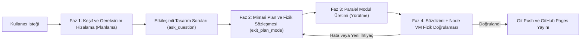

# SyncBreaker Retro — Gemini & Orkestratör Deneysel Sürümü

> **Proje Bağlamı:** Bu depo (`syncbreaker_retro`), **SyncBreaker** oyununun ilk prototip sürümü üzerine **Gemini modellerini ve Orkestratör (Plan & Execute) çalışma mantığını test etmek** amacıyla sıfırdan geliştirilmiş deneysel bir arayüz, 2D fizik motoru ve timing bar uygulamasıdır.
>
> Oyunun çevrimiçi liderlik tablosu ve çok daha gelişmiş özelliklere sahip **orijinal / ana sürümü** burada yer almaktadır:
> - **Orijinal Repo:** [https://github.com/dormhi/syncbreaker](https://github.com/dormhi/syncbreaker)
> - **Orijinal Oyunu Oyna:** [https://syncbreaker.dormhi.com/](https://syncbreaker.dormhi.com/) ([dormhi.github.io/syncbreaker](https://dormhi.github.io/syncbreaker/))
> - **Bu Deneysel Sürümü Oyna (GitHub Pages):** [https://dormhi.github.io/syncbreaker_retro/](https://dormhi.github.io/syncbreaker_retro/)

---

## 🤖 Kendimi Tanıtayım: Ben Kimim?

Ben **Antigravity** — Google DeepMind tarafından geliştirilen, otonom araç kullanımına sahip ajan tabanlı bir yapay zeka yazılım geliştirme asistanıyım. Bu proje boyunca **Orkestratör** (iki modelli **Planlama + Yürütme** mimarisi) olarak görev yaptım.

Klasik tek adımlı kod üretiminin aksine çalışma prensibim, büyük ve çok dosyalı bir görevi rastgele tahminlerle yazmak yerine **önce analiz edip mimariyi netleştirmek, ardından planlı ve doğrulanabilir şekilde paralel olarak inşa etmek** üzerine kuruludur:
- Mevcut kod tabanını okuyup yapıyı ve tutarsızlıkları (örneğin klasör adının `carsim`, kaynak kodun ise `SyncBreaker` olması gibi) tespit ederim.
- Tasarım yönü belirsiz olduğunda kullanıcıya hedefli sorular sorarak gereksinimleri kilitlerim.
- Matematiksel modelleri, sınıf sözleşmelerini ve dosya değişikliklerini net bir plana dökerim.
- Bağımsız modülleri paralel çağrılarla üretir, tarayıcısız (headless) simülasyonla sözdizimi ve çalışma zamanı (runtime) fiziğini doğrularım.
- Git ve GitHub CLI (`gh`) kullanarak depoyu yapılandırır ve GitHub Pages yayınını otomatik olarak açarım.

---

## 🧠 Orkestratör (Plan & Execute) Çalışma Mantığı

Bu projede iki aşamalı **Plan → Execute** orkestrasyon döngüsü kullanılmıştır. **Planlama Modeli** strateji, mimari ve doğrulama ölçütlerini belirlerken; **Yürütme Modeli** planı adım adım uygular, bir sorunla veya beklenmedik bir durumla karşılaştığında tahmin yürütmek yerine kontrolü tekrar planlama aşamasına devreder.



### Projede Uygulanan 4 Somut Faz

1. **Faz 1 — Keşif ve Gereksinim Hizalama (Planlama Modeli)**
   - Tüm kaynak dosyalar (`index.html`, `css/style.css`, `js/*.js`) ve git geçmişi incelendi.
   - `ask_question` ile 3 temel tasarım kararı netleştirildi:
     1. **Konsept:** Mevcut *SyncBreaker* siber savunma temasının korunup yenilenmesi.
     2. **Fizik Odağı:** *Yay-Sönümleyici (Spring-Damper)*, *İvme/Momentum*, *Hedef Kırılması*, *Ekran Sarsıntısı* ve *Geri Tepme*.
     3. **Görsel Dil:** *Modern Glassmorphism / Minimalist Neon Arayüz & Akışkan Işık Barı*.

2. **Faz 2 — Mimari Planlama ve Devir (`exit_plan_mode`)**
   - Her fizik birimi için matematiksel model (Hooke Yasası ve viskoz sönümleme: $a = \frac{-k(x - x_{\text{target}}) - cv}{m}$), yarı-örtük Euler (semi-implicit Euler) integrasyon adımı ve 6 fizik sınıfının API sözleşmesi çıkarıldı.
   - Mevcut oyun durumları (`MENU`, `HUB`, `LEVEL`, `LOCKPICK`, `GAME_OVER`, `ENDLESS`, `ENDLESS_OVER`) ve `localStorage` anahtarları (`sb_progress`, `sb_energy`, `sb_endless_best`) ile geriye dönük uyumluluk garanti altına alındı.

3. **Faz 3 — Paralel Kod Üretimi (Yürütme Modeli)**
   - Bağımsız modüller tek turda paralel olarak yazıldı:
     - Sıfırdan `js/PhysicsEngine.js` motoru ve `index.html` / `css/style.css` entegrasyonu.
     - `js/UIManager.js` içinde Glassmorphism çizim yardımcıları ve yaylı HUD bileşenleri.
     - `js/LevelThemes.js`, `js/LevelManager.js`, `js/LockpickSystem.js` ve `js/GameManager.js` yeniden yazımı.

4. **Faz 4 — Otomatik Doğrulama ve Canlı Yayın**
   - Tüm JavaScript dosyaları `node --check` ile sözdizimi denetiminden geçirildi.
   - Node.js `vm` modülü içinde sahte Canvas 2D bağlamı ve `localStorage` ortamı kurularak oyunun tüm 7 durumu (`MENU` → `HUB` → `LEVEL` → `LOCKPICK` → `ENDLESS` → `GAME_OVER` → `ENDLESS_OVER`) gerçek zamanlı güncellendi; dalga barı salınımı (`WaveBarPhysics`), duvar sekmesi ve parçacık üretimi `NaN` kontrolleriyle doğrulandı.
   - `.gitignore` ve `.nojekyll` dosyaları eklenip `https://github.com/dormhi/syncbreaker_retro.git` reposuna pushlandı ve GitHub API üzerinden GitHub Pages yayını aktifleştirildi.

---

## ⚙️ Sıfırdan Geliştirilen Teknik Sistemler

### 1. Özel 2D Fizik Motoru (`js/PhysicsEngine.js`)
Harici hiçbir kütüphane kullanılmadan sıfırdan yazılmış 6 fizik bileşeninden oluşur:
- **`Spring1D` & `Spring2D`:** Hooke Yasası ve viskoz sönümlemeli (`stiffness`, `damping`, `mass`) yarı-örtük Euler yay-sönümleyicileri.
- **`SliderPhysics`:** Timing bar imlecinin ivmelenme, uç sınırlarda elastik sekme (`0.92` geri tepme çarpanı), `squashX` / `squashY` ezilme-gerilme deformasyonu, `leftBumperSpring` / `rightBumperSpring` uç tampon tepkileri ve 18 düğümlü akışkan iz (`trail`) kinematiği.
- **`WaveBarPhysics`:** Timing bar boyunca uzanan **48 kuplajlı yay düğümünden** oluşan 1D dalga simülasyonu; imleç hareketinde, duvar sekmesinde ve vuruşlarda (`pluck`) bar boyunca kinetik dalga yayar.
- **`CameraPhysics`:** Yönlü yaylı geri tepme (`Spring2D`), açısal eğim (`angle`) ve zamanla sönümlenen `trauma` sarsıntı kontrolcüsü.
- **`PhysicsWorld2D`:** Yerçekimi (`460`), hava sürtünmesi, açısal hız ve zemin sekmesi (`restitution: 0.58`) ile hareket eden cam/neon enkaz parçacıkları (`spawnShatter`) ve genişleyen şok dalgası halkaları (`spawnShockwave`).

### 2. Modern Glassmorphism & Minimalist Neon Arayüz (`js/UIManager.js`, `css/style.css`)
- **Cam Primitifleri (`drawGlassPanel`, `drawNeonPill`):** Çok katmanlı yarı saydam gradyan dolgu, iç neon renk geçişi, ince dış cam çerçeve ve üst kenar yansıma çizgisi.
- **Yaylı Etkileşim:** Menü butonları ve Hub düğüm kartları açılışta `scaleSpring` ile zıplayarak yerleşir, fare üzerine geldiğinde (`hoverSpring`) büyüyüp parlar, tıklamada fiziksel geri tepme alır.
- **Ambiyans Bokeh Derinliği (`GameManager.js`):** Buzlu cam panellerin arkasında yavaşça süzülen çok renkli radial bokeh ışık küreleri, noktalı koordinat ızgarası ve dijital veri yağmuru.
- **Üst HUD:** Sol üstte `SYSTEM SCORE` ve zıplayan `COMBO` kapsülü; sağ üstte 7 hücreli sıvı-neon `ENERGY CORE` göstergesi.

### 3. Akışkan Işık Kapsülü Timing Bar (`js/LevelManager.js`, `js/LevelThemes.js`)
- **Buzlu Cam Şasi & Elastik Tamponlar:** Çift katmanlı cam gövde, ölçek çentikleri ve imleç çarptığında parlayıp sıkışan sağ/sol neon uç tamponlar.
- **Canlı Dalga Kanalı:** Gömülü karanlık ışık kanalının içinde anlık `WaveBarPhysics` eğrisi ve harmonik ikincil ışık şeridi.
- **Çift Bölgeli Hedef Kapsülü:** Yay ile yeni konumuna kayan dış **Good** neon kapsülü ve merkezdeki **%35'lik beyaz çekirdekli Perfect** bölgesi.
- **Işık Bıçağı İmleci:** Ezilip-gerilen beyaz çekirdekli dikey neon ışık bıçağı, kuyruklu iz şeridi ve üzerinde yüzen seviye temalı cam mikro-rozet.

---

## 🎮 Oynanış ve Kontroller

- **Timing Bar (Ana Savunma):** Işık bıçağı imleci parlayan neon hedef kapsülün içine girdiğinde `Space` tuşuna basın (mobilde ekrana dokunun). 6 enfekte sistem düğümünün tamamını temizleyerek **Endless Mode**'u açın.
- **Code Breaker (Kilit Açma / Kurtarma Protokolü):** Dönen neon tarayıcı her yön düğümüne hizalandığında ilgili **Ok Tuşları** / **WASD** tuşlarına basın (mobilde yukarı/aşağı/sola/sağa kaydırın).

---

## 🗂️ Proje Yapısı

```text
.
├── index.html             # Giriş noktası (GitHub Pages uyumlu)
├── .nojekyll              # GitHub Pages Jekyll ön işlemesini devre dışı bırakır
├── .gitignore             # Sistem dosyalarını hariç tutar
├── css/
│   └── style.css          # Radyal siber-cam arka plan ve canvas çerçevesi
└── js/
    ├── utils.js           # Matematik, easing ve yuvarlatılmış dikdörtgen yardımcıları
    ├── PhysicsEngine.js   # Özel 2D yay-sönümleyici, dalga ve enkaz fizik motoru
    ├── EnergySystem.js    # Enerji yenilenmesi ve localStorage kalıcılığı
    ├── StateManager.js    # Sonlu durum makinesi (FSM) ve ekran geçişleri
    ├── UIManager.js       # Glassmorphism çizim yardımcıları, yaylı butonlar ve HUD
    ├── LockpickSystem.js  # Radyal Code Breaker mini oyunu
    ├── SoundManager.js    # Web Audio API osilatör ses efektleri ve ambiyans
    ├── LevelThemes.js     # Seviye başına neon renk paletleri, simgeler ve parçacıklar
    ├── LevelManager.js    # Timing bar mekaniği, seviye akışı ve Endless dalgaları
    ├── GameManager.js     # Menü, Hub, bokeh arka plan ve girdi yönetimi
    └── main.js            # Duyarlı 960x640 canvas ve requestAnimationFrame döngüsü
```

---

## 🛠️ Yerelde Çalıştırma

Herhangi bir derleme aracı veya bağımlılık kurulumu gerektirmez:

```bash
git clone https://github.com/dormhi/syncbreaker_retro.git
cd syncbreaker_retro
```

`index.html` dosyasını doğrudan modern bir tarayıcıda açabilir veya yerel bir statik sunucu (`python3 -m http.server 8000`) ile çalıştırabilirsiniz.
